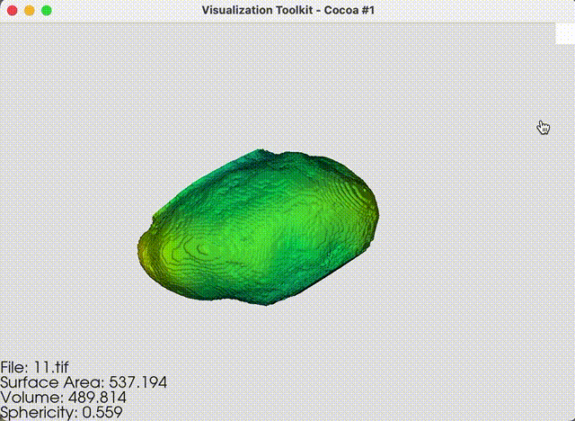

# Open-Source 3D Cellular and Organelle Morphometric Analytical Tool

Full research manuscript available [here](./lib/researchManuscript.pdf).

## Overview

Morpheus is an image analysis and 3D visualisation pipeline developed as my final-year undergraduate capstone project. It enables the morphometric quantification of nuclear shape and structure from confocal microscopy stacks.

## Features:

- GUI-based input/output management
- Batch analysis of `.tif` volume stacks
- Real-time 3D mesh visualisation with centroid heatmaps
- Automatic CSV logging of morphometric metrics

Confocal microscopy stacks -> Random Forest Classifier preprocessing -> Marching-Cubes mesh generation -> Batch morphemetric analysis and visualisation

## Output:

For each volume:

- Surface Area
- Volume
- Sphericity

Logged to CSV and rendered in an interactive 3D viewer.

## Requirements

See `requirements.txt`. Install dependencies with:

pip install -r requirements.txt

The segmented confocal microscopy .tif stacks for TSA and Control groups are available [here](./dataset/).

To batch analyse a group, run the program, and set the input directory to the dataset/ group you wish to batch-analyse, as an example.

Set the output directory and file name - this will save the data in a .csv file. 

Once analysed, press visualise.

## Development Notes

This tool was developed over two weeks, building upon experimental design, classifier pipeline planning, and morphometric quantification techniques conceived earlier in the project (8 week total duration).

## Author

Samuel Clucas

BSc, Biological Sciences (First) – Durham University

Incoming MRes Biomedical Data Science – Imperial College London
